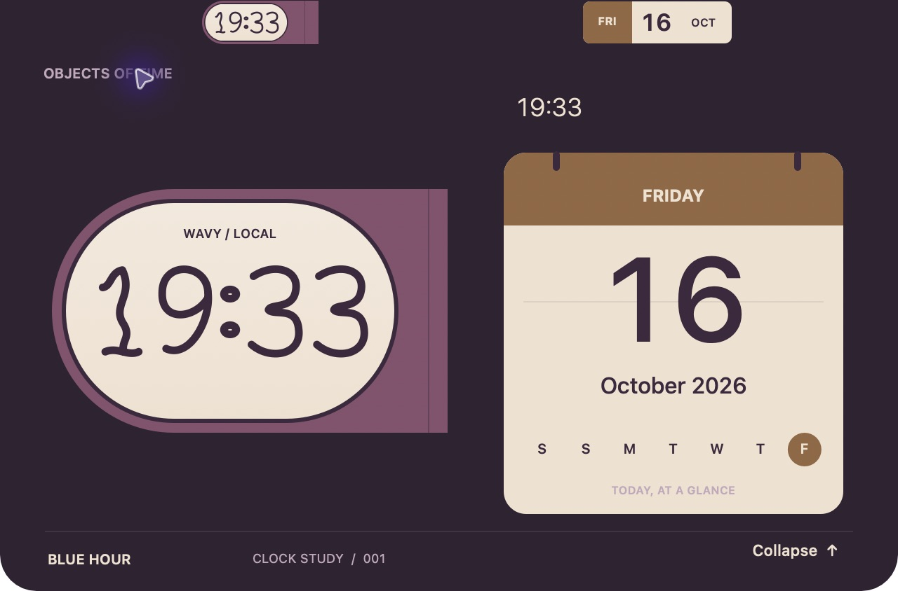

# Wavy Clock


A native macOS notch bar for expressive clocks, a calendar, and AI subscription usage. Built with Swift and AppKit, with no package dependencies.

Wavy Clock starts with the visual details: sculpted clock faces, playful hands, warm colors, and compact objects that open into a larger desk of widgets. Rich components and animation are the main reason this project exists.

## Current look

The compact bar places a clock on the left of the notch and a companion widget on the right. Its height follows the selected display's menu-bar geometry.


Click either wing to open the expanded panel.



These are screenshots of the running AppKit app on a 14-inch MacBook Pro, using the Blue Digital clock, a calendar, and the Plum & brass palette. They include the custom Wavy numerals from [PR #2](https://github.com/k4vrin/macos-floating-clock/pull/2). The default `main` branch currently has the counter-style digital clock; the Wavy family and custom numerals are in the [open PR stack](https://github.com/k4vrin/macos-floating-clock/pulls). Screenshots show the app window itself, so the physical camera notch is not included.

## What works

- Analog and digital clocks with compact and expanded layouts.
- An independently selected calendar or Codex/Claude usage widget on the right.
- Installable JSON packs for clock designs, widgets, and color palettes.
- A monitor selector, saved selections, 12/24-hour time, reduced animation, and start-expanded settings.
- Display-aware menu-bar sizing and positioning, including notch exclusion.
- Refresh scheduling that changes with compact/expanded state and app lifecycle.

The next visual work is to bring calendar and usage components into the same Wavy family and add a continuous hover-driven morph between compact and expanded views. The current transition uses click-to-expand with animated resizing.

## Build and run

You need macOS 13 or later and an Xcode toolchain with Swift 6 and the macOS SDK.

```sh
git clone https://github.com/k4vrin/macos-floating-clock.git
cd macos-floating-clock
zsh scripts/build-app.sh
open 'build/Wavy Clock.app'
```

The script builds the release executable with SwiftPM, packages it as an app, and applies an ad-hoc signature. This is a local development build; there is no notarized installer yet. Open `Package.swift` in Xcode to work on the project.

To try the Wavy numeral preview shown above before it merges:

```sh
git switch --track origin/feature/notchbar-wavy-numerals
zsh scripts/build-app.sh
open 'build/Wavy Clock.app'
```

Quit a running copy before rebuilding. In Settings, choose a digital clock and the Wavy visual family.

Run the tests with:

```sh
swift test
```

## Customize the bar

Right-click either compact wing and open **Settings…** to select a monitor, clock, companion widget, and palette. Use **Install Theme or Clock Pack…** to import a declarative pack.

Try the included examples:

- [Blue Hour](examples/blue-hour.clockpack.json), additional analog and digital designs.
- [Desk Widgets](examples/desk-widgets.clockpack.json), calendar and usage designs.
- [Tide Pool](examples/tide-pool.clockpack.json), a palette-only pack.

Packs configure the app's built-in renderers. They do not load executable third-party code. The Wavy/Counter visual-family selector is currently part of the open PR stack.

## Usage connections

The usage widget can show Codex subscription limits through the local Codex connection. Claude requires its status-line connection to be configured. An unavailable or disconnected provider is shown explicitly. See [provider setup and limitations](docs/RIGHT_SIDE_WIDGETS.md).

## Project notes

This is an early prototype. The reference machine is a 14-inch MacBook Pro with M1 Pro. Geometry tests cover notched and non-notched inputs, but the app has not been verified on every Mac, macOS version, display arrangement, or full-screen configuration. Launch at login and a signed, notarized release are still pending.

| Guide | Contents |
| --- | --- |
| [Roadmap](docs/ROADMAP.md) | Milestones and acceptance criteria |
| [First clock verification](docs/FIRST_CLOCK.md) | Recorded checks and resource measurements |
| [Compact geometry](docs/COMPACT_GEOMETRY.md) | Menu-bar sizing and display placement |
| [Clock packs](docs/CLOCK_PACKS.md) | Pack architecture and JSON format |
| [Theme plugins](docs/THEME_PLUGINS.md) | Palette installation and selection |
| [Settings](docs/SETTINGS.md) | Preferences and defaults |
| [Architecture](docs/ARCHITECTURE.md) | AppKit components and lifecycle |
| [Testing](docs/TESTING.md) | Compatibility and performance checks |
| [Visual inspiration](docs/INSPIRATION.md) | Physical clock references and design direction |

The product name is provisional. Some early planning documents describe future behavior; the implemented features and limits above describe the current app.
