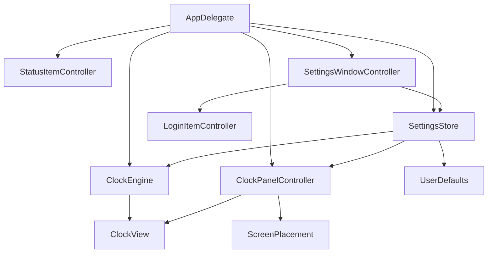

# AppKit architecture

> Implemented addition, 2026-10-16: [Right-side widgets](RIGHT_SIDE_WIDGETS.md) documents reusable calendar and AI usage items, independent slot selection, Codex app-server refresh, and the Claude status-line bridge.

> Implemented update, 2026-10-16: [Clock packs](CLOCK_PACKS.md) defines the digital clock and installable multi-clock sets. It supersedes earlier exclusions of clock packs or a second clock design. Version 1 uses native renderer templates and declarative JSON.

## Rendering direction update, 2026-10-16

Rich clock components and animation are core product goals. Separate wall-time sampling from visual presentation and transition state. Native text may support labels and accessibility, but is not the prescribed renderer for every face. Evaluate AppKit drawing, Core Graphics, and Core Animation per design. The earlier text-only rendering and short-transition restrictions below are superseded. Do not choose an animation engine or continuous drawing loop before a prototype establishes the need.

> Direction update, 2026-10-15: [Inspiration and notch bar direction](INSPIRATION.md) records the owner's latest concept and takes precedence over conflicting statements here. This document describes the earlier floating-clock baseline and needs revision before implementing the notch bar.

Status: recommended design, unimplemented. Required constraints and proposed choices are separated in [Decisions](DECISIONS.md).

## Components and ownership

One app target with a few folders is sufficient. Do not start with packages, a service container, an event bus, or a general widget framework.

| Component | Responsibility and lifetime |
|---|---|
| `AppDelegate` | Application lifecycle and composition. Retains controllers and tears down observers/timers on termination. |
| `ClockPanelController` | Owns one `NSPanel` and its `ClockView`; applies visibility, geometry, and floating policy. |
| `ClockView` | Custom `NSView` that lays out native read-only text fields and optional date. Renders display state without owning a timer or persistence. |
| `ClockEngine` | Reads a supplied time provider, formats current state, owns one scheduled update, publishes changed strings. |
| `SettingsStore` | Holds validated settings, loads/saves versioned `UserDefaults`, emits targeted change callbacks. |
| `SettingsWindowController` | Owns a standard AppKit settings window and controls. Applies edits through the store. |
| `StatusItemController` | Retains the `NSStatusItem`, constructs menu actions, and routes commands. |
| `ScreenPlacement` | Small geometry helper for display matching, frame clamping, and restored placement. No independent polling. |
| `LoginItemController` | Wraps `SMAppService.mainApp`, reports actual status and errors to Settings. |

These are proposed responsibilities, not a mandate for one protocol per class. Inject a time provider and a settings backend where tests need control. Add other interfaces only when a real test or platform boundary needs them.

## Lifecycle

At launch, initialize `NSApplication`, load and validate settings, retain the status item, create the panel, resolve a reachable frame, format current time, and show the clock. Use accessory activation policy so normal operation has no Dock icon. Do not terminate when Settings closes.

When opening Settings, activate the application deliberately and make the standard settings window key. Passive clock refreshes and dragging must not activate it. Closing Settings returns to passive operation.

Observe system events once. Route clock/time-zone/locale changes to the engine, screen changes to placement, and workspace sleep/wake events to both. Coalesce repeated notifications into one main-thread reconciliation. Hidden or sleeping operation cancels display scheduling. Showing or waking refreshes from wall time and schedules the next boundary. On termination, cancel the timer, detach observers, and finish pending position persistence.

## Rendering and concurrency

Own mutable UI state and timer callbacks on the main thread, preferably through Swift main-actor isolation. Formatting a few cached strings does not justify background queues. Rebuild formatters when relevant settings or locale/time zone change. Compare complete display state before assigning text or invalidating layout.

Use native text rendering for font fallback and accessibility. Core Graphics is available for simple backgrounds or geometry if needed. Core Animation is a candidate for expressive transitions and layered clock components. Decide whether any face needs continuous hand motion during design, then measure it. Suspend animation work when hidden or asleep; avoid a permanent redraw loop solely for transitions that have finished.

## API and compatibility review

| API | Intended use and verified constraint |
|---|---|
| `NSApplication`, `NSApplicationDelegate`, `NSStatusItem` | Accessory lifecycle and menu-bar entry point. Retain the status item for app lifetime. |
| `NSPanel`, `NSView`, `NSWindow.Level.floating` | Passive clock presentation; prototype focus and z-order before freezing configuration. |
| `NSScreen.visibleFrame` | Re-read usable desktop geometry on changes. |
| `NSScreen.safeAreaInsets` | macOS 12+. Reserved for later notch/custom full-screen work. |
| `canJoinAllApplications` | macOS 13+. Candidate for Stage Manager and eligible full-screen participation. |
| `SMAppService` | macOS 13+. Native opt-in login registration. |
| `Date`, `Calendar`, `DateFormatter` | Current wall time and localized presentation. `Date.FormatStyle` is an alternative, available before the proposed baseline. |
| `Timer`, `DispatchSourceTimer` | Evaluate scheduling alternatives; one-shot main-run-loop Timer is recommended initially. |
| `NSWorkspace` notifications | Observe sleep/wake through the workspace notification center, distinct from default-center notifications. |

Installed SDK headers confirmed macOS 12 availability for screen safe-area properties, macOS 13 for `canJoinAllApplications`, and legacy clock/time-zone notifications predating the proposed baseline. Current typed Foundation notification APIs may have newer availability; do not adopt them without checking the deployment target. No obsolete login-helper API is needed.

## Permissions and distribution

The planned app reads its own settings and controls its own windows. No cross-app automation, global input hook, screen capture, or private WindowServer APIs are needed. Validate the no-sensitive-permission expectation during M0. Launch-at-login state is separate from privacy permissions.

For public release, select sandbox policy and either Developer ID signing/notarization or Mac App Store distribution. Document the actual entitlements and test the installed signed bundle. Do not add a privileged helper. App Store acceptance is not established by this plan.

SwiftUI might later simplify a separate settings screen or support a WidgetKit extension. Either requires a new scope decision; the clock and settings in this MVP remain AppKit.

## References

Checked 2026-10-15: [NSPanel](https://developer.apple.com/documentation/appkit/nspanel), [NSStatusItem](https://developer.apple.com/documentation/appkit/nsstatusitem), [SMAppService](https://developer.apple.com/documentation/servicemanagement/smappservice). Detailed window and time references are in their owning documents.

## Implemented settings and themes, 2026-10-16

`AppPreferences` persists monitor UUID selection, theme, time format, reduced animations, and launch expansion state. `DisplayChoice` selects the target screen before `MenuBarGeometryResolver` computes its frame. `SettingsWindowController` sends preference and component callbacks to `AppDelegate`; it does not own placement or usage fetching. `ThemeDesign` extends data-only clock packs with optional palettes, applied independently to each native renderer. See [Settings](SETTINGS.md) and [Theme plugins](THEME_PLUGINS.md). Earlier floating-clock component diagrams remain planning history where they differ from these implemented classes.
