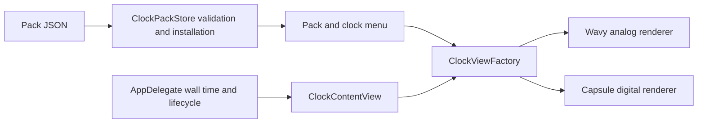

# Clock packs

Status: implemented prototype, 2026-10-16. This expands the earlier single-clock scope. The shipped Originals set contains The Wavy One and The Digital One. Both have compact and expanded views. The compact digital clock retains the horizontal rounded dial and flat mounting end from the owner's reference, with cream/red materials and split-flap-style digit tiles.

> Extension, 2026-10-16: [Right-side widgets](RIGHT_SIDE_WIDGETS.md) adds independently selected calendar and AI usage widgets to the same pack format. `widgets` is optional, and `clocks` may be empty in a widget-only pack.

## Ownership



`ClockPack` and `ClockDesign` are versioned Codable data. `ClockPackStore` validates, installs, and reloads manifests. `ClockViewFactory` maps supported renderer IDs to native views. `NotchItemView` defines the host contract: date, accent, and optional expand action. `ClockContentView` replaces compact and expanded renderer instances together and supplies accessible names. `AppDelegate` owns selection, the menu, the window, sleep handling, and the single boundary timer.

A pack cannot schedule timers, run scripts, load binaries, fetch resources, or change window geometry. The host sends the same sampled `Date` to both presentations. Compact refreshes at minute boundaries; expanded refreshes each second. Packs have no continuous idle animation loop. Panel expansion respects Reduce Motion. Richer face-specific transition animations remain future work.

## Install a set

Open the app's clock menu and choose **Install Clock Pack…**, then select a JSON manifest. The included `examples/blue-hour.clockpack.json` installs a second set containing Blue Wavy and Blue Digital. Choose a design under **Clocks → pack name → clock name**. Selection persists in `UserDefaults` under `selectedClock` as `packID/clockID`.

Installed manifests live at `~/Library/Application Support/WavyClock/ClockPacks/<packID>.json`. The store copies only validated, re-encoded JSON with an atomic write. Installation rejects duplicate pack IDs and leaves the previous installation intact. For this prototype, remove an installed manifest while the app is stopped to uninstall or replace a pack; there is no in-app removal/update UI yet.

Missing or invalid selected clocks fall back to the built-in analog clock. Startup skips corrupt installed manifests, logs their filename/error, and continues loading other packs. These diagnostics are currently in the application log, not an installed-pack management screen.

## Version 1 contract

```json
{
  "schemaVersion": 1,
  "id": "studio.collection",
  "name": "My clock set",
  "clocks": [
    {"id": "analog", "name": "My Wavy Clock", "renderer": "wavyAnalog", "accent": "237CA3"},
    {"id": "digital", "name": "My Digital Clock", "renderer": "capsuleDigital", "accent": "237CA3"}
  ]
}
```

| Field | Constraint |
| --- | --- |
| schemaVersion | Exactly 1; incompatible versions fail explicitly |
| pack id | 1–80 characters, lowercase ASCII letters/digits/dots/hyphens, begins with a letter or digit; built-in ID is reserved |
| clock id | Same format; unique within its pack |
| name | Nonblank, at most 60 characters |
| clocks | 0–24 definitions per pack; at least one clock or widget required |
| clock renderer | `wavyAnalog` or `capsuleDigital`; unknown renderers fail |
| widgets | Optional array, up to 24 items; `flipDate` and `aiUsage` renderers |
| accent | Six RGB hexadecimal digits without `#` |
| file | Regular JSON file, at most 64 KiB; symbolic-link manifests rejected |

The extension is conventional, not required. Schema version governs compatibility; pack release/update versioning is not implemented. Unknown JSON fields are ignored by Codable and have no runtime effect. Accent changes the housing and analog hour hand. Other materials and layout are renderer-owned in v1.

This is an installable declarative pack system. Completely new shapes, components, or animation behavior require a new renderer shipped in an app update. Arbitrary third-party native code, downloadable shaders, image assets, ZIP extraction, marketplace distribution, automatic updates, and custom animation scripts are outside v1. Add renderer capabilities deliberately rather than exposing executable code through the manifest.

## Verification

`swift test` covers time/geometry invariants plus unsupported versions/renderers, invalid IDs/colors, oversized manifests, duplicate clock IDs, reserved IDs, symlink rejection, installation/reload, duplicate preservation, and corrupt-file isolation. Release packaging uses `scripts/build-app.sh`. Run the app with `--digital` to preview the digital original without changing saved selection. `--digital --performance-probe output/digital-resource-samples.csv` measures compact, expanded, transition, and recovered compact phases.

Further release checks include long-run memory/battery behavior, older macOS runtime coverage, signed distribution, sandbox file access, and in-app pack removal/update controls.

## Observed prototype check, 2026-10-16

Release build and six XCTest methods passed. Native UI inspection confirmed compact and expanded digital views, importing the Blue Hour manifest through the file picker, the installed pack appearing in the Clocks menu, and selecting Blue Digital updating both views and the pack footer. The original digital design was restored afterward. Right-clicking the clock also opens the status menu. Screenshots and raw resource samples remain in ignored `output/`, outside the vault.

A 72-second digital probe on the development Mac sampled CPU at one-second intervals and measured RSS and physical footprint. CPU uses one core as 100%; steady averages exclude the first two samples of each resting phase.

| Phase | Mean CPU | Physical footprint | RSS |
| --- | ---: | ---: | ---: |
| Compact | 0.52% | 24.3–28.0 MiB | 78.0–85.2 MiB |
| Expanded | 0.42% | 45.4–61.9 MiB | 97.4–97.9 MiB |
| Repeated transitions | 8.49% | 35.8–63.1 MiB | 98.2–99.8 MiB |
| Recovered compact | 0.03% | 30.2–38.7 MiB | 99.4–99.8 MiB |

Startup and screenshot inspection occurred during this short run. These measurements include the probe's one-second sampling overhead. They do not prove battery life or absence of a long-run leak; RSS remained higher after expanded rendering.
