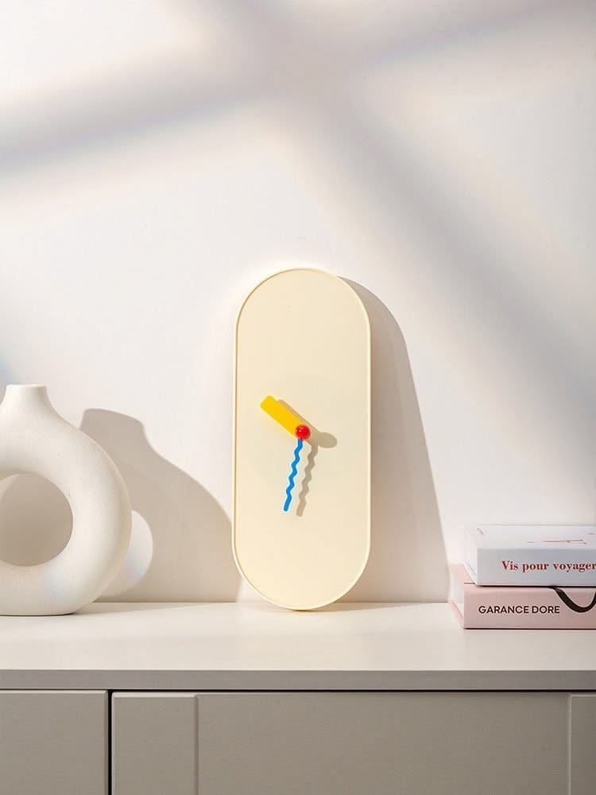
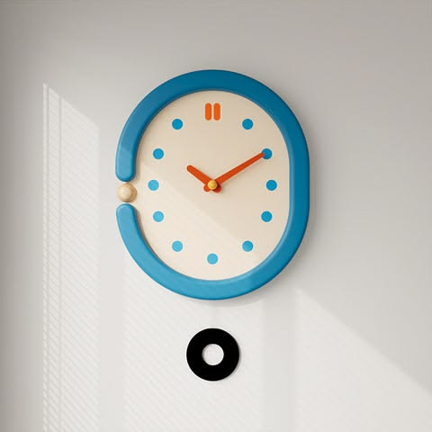
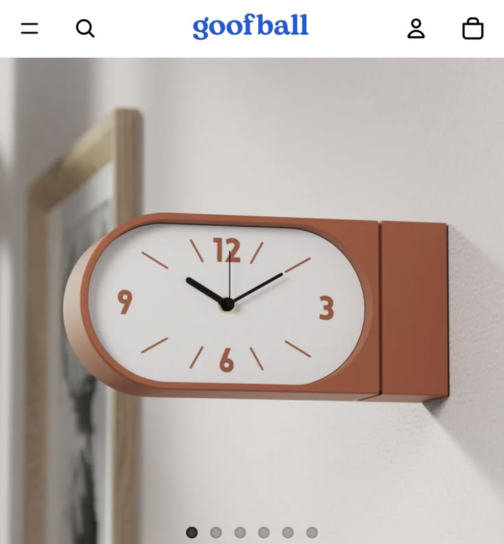
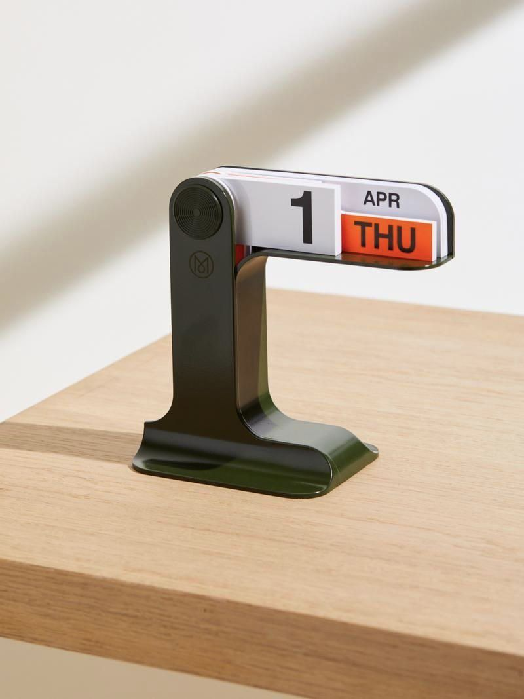
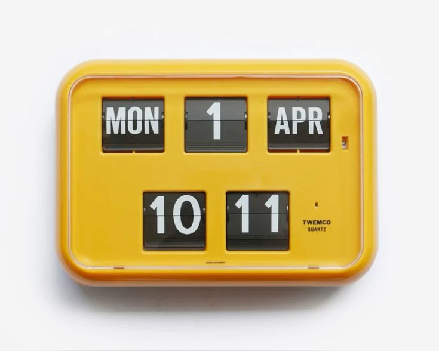
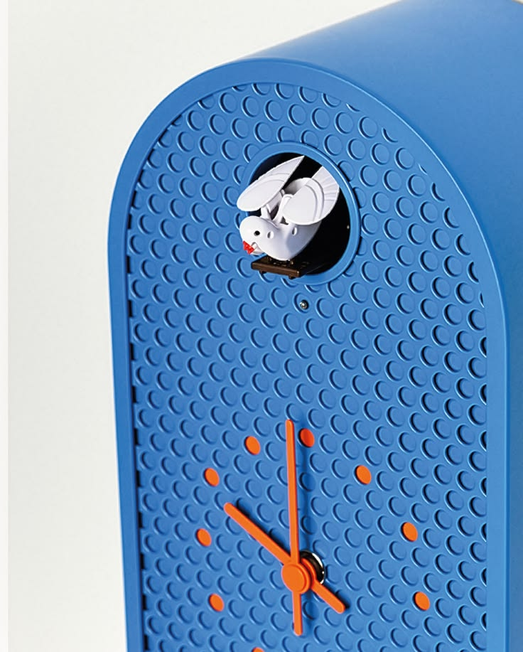
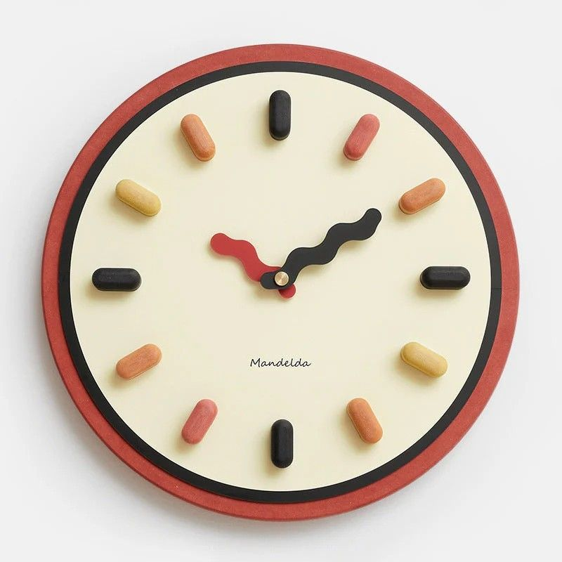

# Clock inspiration and notch bar direction

## Compact clock form correction, 2026-10-16

The owner clarified that REF-03's horizontal clock is the compact clock's form reference, not merely inspiration for rounding the enclosing bar. Compact mode must show an actual analog dial in that elongated body, with a rounded outer end and a square mounting end toward the notch. Retain the expanded Wavy face's cream dial, red housing/rim, colored markers, and wavy red/black hands. Do not copy the reference's straight hands, typography, or terracotta palette as a new clock theme.

Implemented the miniature analog clock on the left, with the existing short date on the right. It occupies the existing menu-bar-height bounds; no taller compact window or second timer was added. Main and compact faces share the same wavy-hand drawing and current-time sample. Hands fit the elongated dial at every angle. Clicking the miniature clock expands the main view, and it exposes an accessible button with the current time.

The current miniature is 84 points wide and as tall as the bar. The black outer pill with digital time is superseded. The expanded circular face remains the main clock. Live expansion/collapse was checked and actual window screenshots were saved under ignored `output/screenshots/compact-horizontal-live.png` and `output/screenshots/expanded-horizontal-live.png` in the project checkout.

## Visual priority, 2026-10-16

The owner is creating this project primarily for its aesthetics, rich UI components, and animations. A visually distinctive result is a central product goal. Treat clock faces, materials, depth, expressive details, and compact-to-expanded motion as core design work, with readability and accessibility built into that work.

The supplied physical clocks guide the visual character. Expansion/collapse, clock switching, and component feedback should receive deliberate motion design. Exact effects, durations, and face selection remain open; the owner has established the priority, not a finished motion specification. This supersedes earlier guidance to keep the product text-only or exclude decorative animation.

Captured 2026-10-15 from seven images supplied by the owner. These local copies preserve the original images without cropping or modification. They are visual references, not finished interface designs. Original source URLs and authorship were not supplied; visible brand text is part of the reference photography, not proposed app branding.

## Latest product direction

The owner wants a compact notch bar that extends horizontally on both sides of the MacBook's notch. In compact mode, its height must exactly match the macOS status/menu bar, and its lower edge must not extend below the notch. Do not turn the compact state into a panel hanging beneath the camera housing.

In expanded mode, the app can reveal the larger, expressive clocks inspired by the references below. The user can switch clock designs. The direction is playful physical clock design, including analog faces and flip-style displays, rather than limiting the app to plain digital typography.

The two sides can serve different purposes: a clock on one side, and potentially a date widget or AI subscription usage widget on the other. Date and usage are ideas to explore, not approved integrations or a finalized release scope. Which side holds the clock is not yet specified.

This direction supersedes the earlier recommendation to defer notch placement and start with a freely movable text-only floating clock. The existing technical documents preserve that initial proposal and need a coordinated revision before implementation. Swift and AppKit remain the requested stack. No app code, API integration, or runtime geometry verification was added in this capture step.

## Compact silhouette correction, 2026-10-16

The owner selected REF-03, the horizontal terracotta clock, as the reference for the compact form specifically. Use a horizontal body with a rounded outer cap and a straight inner edge against the notch, mirrored for the other wing. The notch joins the inner edges; the outer contour reads as a slim capsule. Keep the menu-bar height constraint. This correction does not select the photographed clock face, numerals, hands, or terracotta color, and does not change the expanded Wavy face.

## State and layout intent

| State | Owner's intent | Still to determine |
|---|---|---|
| Compact | Extend to the left and right of the notch, exactly menu-bar height, with no content below the notch | Width of each side, compact content, menu-item collision handling, behavior when menu-bar height and notch geometry differ |
| Expanded | Reveal the characterful clock designs; allow switching between clocks | Expansion trigger, dimensions, whether both sides expand together, dismissal, animation |
| Companion content | Explore a date display or AI subscription usage on the opposite side from the clock | Widget choice, provider, authorized data access, freshness, offline/error states |

Treat menu-bar height as a runtime geometry requirement, not a fixed point value inferred from these photographs. The photos illustrate clocks and calendar objects; none demonstrates the intended notch layout. Screen scaling, full-screen/menu-bar auto-hide, notched and unnotched displays, and available space around existing menu items still need a design and feasibility pass.

## Reference gallery

### REF-01: Cream capsule with playful hands

Image 1. A tall rounded cream body, no numerals, a straight yellow hand, a wavy blue hand, and a red center. Inspiration to explore: soft silhouettes, warm neutrals, and a small amount of saturated color. The vertical object is an expanded-face reference, not a compact bar proportion.

### REF-02: Blue rounded clock

Image 2. A thick blue rounded frame surrounds a cream face with blue dot markers, orange hands, and a yellow center. The interrupted frame and black ring below add an unusual object-like character. Inspiration to explore: bold outer frames, dot indices, and restrained contrasting accents. No pendulum behavior is implied.

### REF-03: Terracotta horizontal clock

Image 3. A wide terracotta body, rounded white dial, black hands, and strong numerals at 12, 3, 6, and 9. Inspiration to explore: a horizontal clock composition that may suit an expanded side of the bar. The surrounding website interface and brand are not app UI references.

### REF-04: Sculptural flip calendar

Image 4. A dark sculptural stand supports a rounded calendar housing with a large day number, month, and orange weekday card. Inspiration to explore: a companion date widget with a clear hierarchy, segmented information, and one accent color. The stand need not be reproduced in the digital layout.

### REF-05: Yellow flip clock and calendar

Image 5. A yellow rounded housing combines black flip cards for weekday, day, month, hours, and minutes. Inspiration to explore: a coordinated clock/calendar family, large condensed numerals, and mechanical card divisions. A flip animation is a possible treatment, not a requirement established by this image.

### REF-06: Blue textured cuckoo clock

Image 6. A blue arched body has repeated circular texture, orange hands and markers, and a small bird opening. Inspiration to explore: tactile-looking surfaces, rounded geometry, and blue/orange contrast. The bird is a visual reference; sounds, hourly actions, and animated characters are not requested features.

### REF-07: Cream and red clock with wavy hands

Image 7. A cream dial, red rim, dark inner border, raised pill-shaped hour markers, and wavy red/black hands. Inspiration to explore: readable analog structure with irregular hand shapes, soft depth, and a warm palette.

## Shared visual qualities to explore

The reference set favors rounded physical objects, cream backgrounds, bold color accents, and distinctive hands or mechanical cards. Blue/orange and cream/red combinations recur. Shadows, rims, and texture make the clocks feel like small designed objects.

These are observations from the supplied images. They do not finalize seven app themes, exact color values, animation behavior, or a rendering approach. Preserve legibility when adapting decorative hands and markers, especially at smaller expanded sizes. The compact state has a separate geometry constraint and should not shrink every detailed clock into the menu-bar height.

## Next design discussion

Decide what each side shows while compact, how expansion is triggered, and how much room each expanded side may use. Then choose an initial clock face and companion date treatment from this gallery. AI usage remains a separate candidate until the provider and data source are specified. Resolve menu-bar/notch geometry and existing-menu-item conflicts before replacing the earlier requirements with an implementation-ready specification.
