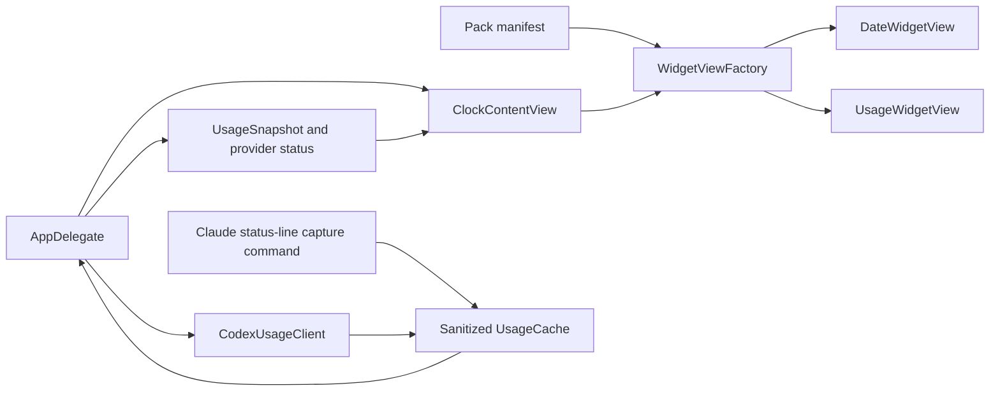
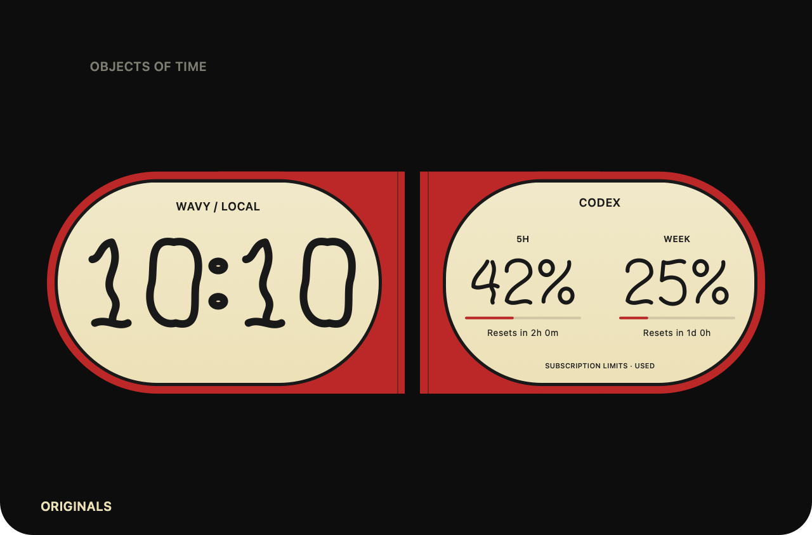
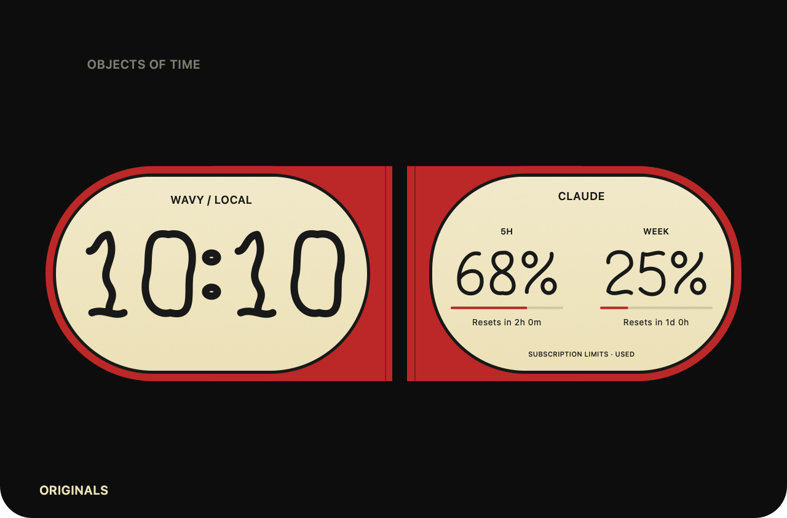

# Right-side widgets

Implemented prototype, 2026-10-16. The right-hand slot is selected independently of the clock. **The Daily One** is a cream and terracotta flip-calendar card. **The AI Desk** contains separate Codex and Claude usage gauges. Each item has compact and expanded presentations, stays inside the existing compact menu-bar height, and expands through the host's existing animation.

## Reusable item architecture

`NotchItemView` is the shared base for clock and widget renderers. It receives wall time, an accent, and an optional press action. `WidgetSurfaceView` adds usage snapshots and provider status. `WidgetViewFactory` creates the compact and expanded pair from a `WidgetDesign`. Renderers own drawing and accessibility labels; they do not own timers, authentication, network clients, or persistence.

`ClockContentView` composes one clock on the left and one widget on the right. `AppDelegate` owns both selections and their lifecycle. Selection persists as `selectedWidget = packID/widgetID` in UserDefaults. Missing selections fall back to the built-in date widget. The main host timer supplies wall time; the calendar invalidates on a day change and AI freshness on a minute change. Locale/time-zone changes invalidate their presentation too.



## Select and install

Right-click the clock or use the menu-bar clock icon, then choose **Right-side Widgets → Originals → The Daily One / The AI Desk**. Clock choice stays independent. Packs may now include optional `widgets` alongside `clocks`; existing clock-only v1 manifests remain valid. A widget-only pack supplies `clocks: []` and at least one widget. Widget IDs are unique within their pack and use the clock ID rules. Names and accent colors use the same bounds and validation as clocks. Up to 24 widgets are allowed per pack.

```json
{
  "schemaVersion": 1,
  "id": "studio.desk-widgets",
  "name": "Desk widgets",
  "clocks": [],
  "widgets": [
    {"id": "date", "name": "Desk Calendar", "renderer": "flipDate", "accent": "D35C3F"},
    {"id": "usage", "name": "AI Desk", "renderer": "aiUsage", "accent": "9BAF84"}
  ]
}
```

Use **Install Clock Pack…** for both clocks and widgets. The extended Blue Hour example includes both. A previously installed copy remains unchanged; v1 rejects replacement installations, so install the separate `examples/desk-widgets.clockpack.json` example to try widget-only packs without replacing Blue Hour.

The host controls which provider data reaches a renderer. A pack can select `flipDate` or `aiUsage` and an accent; it cannot execute scripts or add data providers. New renderers and provider adapters ship through an app update.

## Codex connection

Choose **Connect / Refresh AI Usage**. This selects the AI widget and enables Codex refresh through the installed Codex CLI's `app-server`, using `initialize`, `initialized`, and `account/rateLimits/read`. The app finds the executable in `/opt/homebrew/bin/codex` or `/usr/local/bin/codex`. Codex itself handles its existing sign-in. Wavy Clock never opens credential files or implements a private usage endpoint.

Refresh runs at most once a minute while the AI widget is selected, visible, and awake. Only one request can be in flight. The short-lived process is stopped on completion, timeout, hiding, sleep, deselection, or app termination. Responses have a 256 KiB buffer limit and a 12-second timeout. **Disconnect Codex Usage** disables further requests while retaining the last cache as explicitly cached data. API-key-only or missing subscription windows appear unavailable, not zero.

A Codex app-server process has its own temporary CPU/memory overhead, separate from the host's performance probe. The timeout bounds waiting time; older macOS, unusual CLI installations, and signed/sandboxed distribution remain release checks.

## Claude connection

Claude Code's documented status-line input includes subscription rate-limit windows when available. The app supplies a capture command that accepts this input and writes only provider name, observation time, percentages, window durations, and reset times. It does not persist the rest of the status-line payload. Claude settings are never rewritten automatically.

For this checkout, the command is:

```sh
'/Users/kavrin/Projects/Kavrin/macos-floating-clock/build/Wavy Clock.app/Contents/MacOS/NotchClock' --capture-claude-usage
```

Use **Claude Connection Instructions… → Copy Capture Command** to copy the current app location. In Claude Code settings, set `statusLine.type` to `command` and `statusLine.command` to this command. The file is normally `~/.claude/settings.json`. If you already use a status line, preserve it by having a wrapper read stdin once, tee that data to this capture command with its stdout suppressed, then pass the same data to the original status-line command. Do not replace an existing command without preserving its behavior.

Claude must emit rate-limit data before values appear. Its documented `rate_limits` fields may be independently absent and are available only for supported subscription/gateway sessions after a response. Context-window percentage and API cost are not subscription quota percentages. Wavy Clock reads the resulting local cache each minute while the AI widget is active; **Connect / Refresh AI Usage** also reloads it immediately. There is no Claude OAuth/cookie scraping or network polling.

`--usage-cache-directory <directory>` overrides the capture output only, allowing isolated executable tests without changing the real cache. It has no effect on normal app launches.

## Data correctness and privacy

`UsageSnapshot` holds provider, observation date, and independently optional windows. The adapter prefers `rateLimitsByLimitId.codex`, never another model bucket. It uses the legacy Codex bucket only when the bucket map is absent. Missing, invalid, expired, and disconnected values render as unavailable rather than 0%. Percentages represent **used**, not remaining capacity.

Reset countdowns appear beside the expanded rows. A five-minute-old snapshot is marked stale; compact percentages gain an asterisk. Accessibility descriptions and tooltips include provider state and reset countdowns. Expired windows remain unknown until new provider data arrives; the host does not infer a reset to zero. A provider failure preserves the last reading as cached data.

Caches are atomic JSON writes in `~/Library/Application Support/WavyClock/Usage/{codex,claude}.json`. They are outside the repository and vault. Cache reads reject oversized or malformed snapshots. Pack JSON is a separate source of design configuration and never contains account usage or credentials.

## Validation and remaining work

Unit tests cover Codex bucket selection and genuine zero usage, missing and invalid Claude windows, stale/expired values, partial-window identity, reset labels, cache isolation, widget-only packs, and clock-only compatibility. Native UI checks cover calendar and AI compact/expanded views and live Codex data. The packaged Claude capture command is checked with synthetic input in a temporary directory; a real Claude session connection remains user setup.

The current animation is the shared panel expansion/fade. Per-card flip and gauge-interpolation animations, an installed-pack update/removal screen, custom CLI-path settings, and automatic Claude configuration are not implemented. Avoid claiming live Claude verification until a connected Claude session supplies a real snapshot.

## Provider references

Verified 2026-10-16 against the official [Codex app-server account/rate-limit contract](https://learn.chatgpt.com/docs/app-server) and [Claude Code status-line fields](https://code.claude.com/docs/en/statusline). The implementation uses these public integration boundaries rather than session-cost estimates.

## Observed resource and integration check

On 2026-10-16, all 15 XCTest methods passed, including deterministic Codex initialization, response decoding, cancellation, and a silent-provider timeout. The packaged Claude capture command processed fixture input into an isolated temporary cache; only `provider`, `observedAt`, and `windows` were persisted. No real Claude session was connected during this check.

A 72-second release-app run with the digital clock and AI widget recorded the following host measurements. CPU uses one core as 100%; resting averages exclude the first two samples of each phase. Native screenshot inspection occurred during the run.

| Phase | Mean host CPU | Host physical footprint | Host RSS |
| --- | ---: | ---: | ---: |
| Compact | 0.12% | 27.3–27.5 MiB | 79.3–79.6 MiB |
| Expanded | 0.97% | 51.4–67.1 MiB | 93.2–108.2 MiB |
| Repeated transitions | 8.68% | 44.6–71.0 MiB | 104.9–110.8 MiB |
| Recovered compact | 0.12% | 37.5–46.2 MiB | 100.2–101.9 MiB |

The Codex helper and its descendants were sampled separately every approximately 250 ms. Their combined RSS briefly peaked at 125.2 MiB, with up to four helper processes observed. No helper remained in the final sample. These helpers are outside the host CPU/footprint figures above, so those figures are not total-system cost. Helper CPU was not measured. The short run does not establish battery life or long-run memory stability. Raw samples and screenshots are ignored under `output/` and remain outside the vault.

The widget-only Desk Widgets example was also installed through the native file picker. Its Blue Calendar appeared under Right-side Widgets, applied its accent in compact mode, and left the selected clock unchanged. Both built-in widgets were then checked beside the analog clock. The app was left showing the AI desk with real Codex readings and an unconnected Claude state.

## Provider-specific desks

Choose **Codex Desk** or **Claude Desk** from **Settings → Right side** or the **Right-side Widgets** menu. A desk shows only its selected provider. Both compact and expanded layouts have side-by-side 5H and WEEK slots; the expanded percentages are the dominant text, with smaller window labels, reset times, and connection/freshness details. Existing hover morphing and theme recipes apply to both desks.

The two slots match 300-minute and 10,080-minute windows exactly. Missing and expired windows show `--` rather than substituting another window or provider. The accessibility description and tooltip identify the selected provider, unavailable slots, stale data, and reset times.

Pack widget entries may specify `"provider": "codex"` or `"provider": "claude"` alongside `"renderer": "aiUsage"`. Legacy entries without a provider default to Codex. The existing built-in `usage` ID is retained as Codex Desk so saved selections remain valid. Claude Desk uses `claude-usage`.

Selecting Claude Desk reads its status-line cache and cancels any in-flight Codex request. It does not start Codex refreshes. **Connect / Refresh Codex Usage** explicitly switches to Codex Desk. Claude still needs its existing status-line capture setup; selecting the widget does not connect a provider automatically.

Provider desk previews below use synthetic sample data.





The expanded calendar and provider desks use horizontal capsules aligned to the digital clock housing. The excess vertical housing is removed; the calendar date stays centered, and usage percentages share one row with smaller reset details underneath. Both widgets retain the same compact geometry and hover morph.
