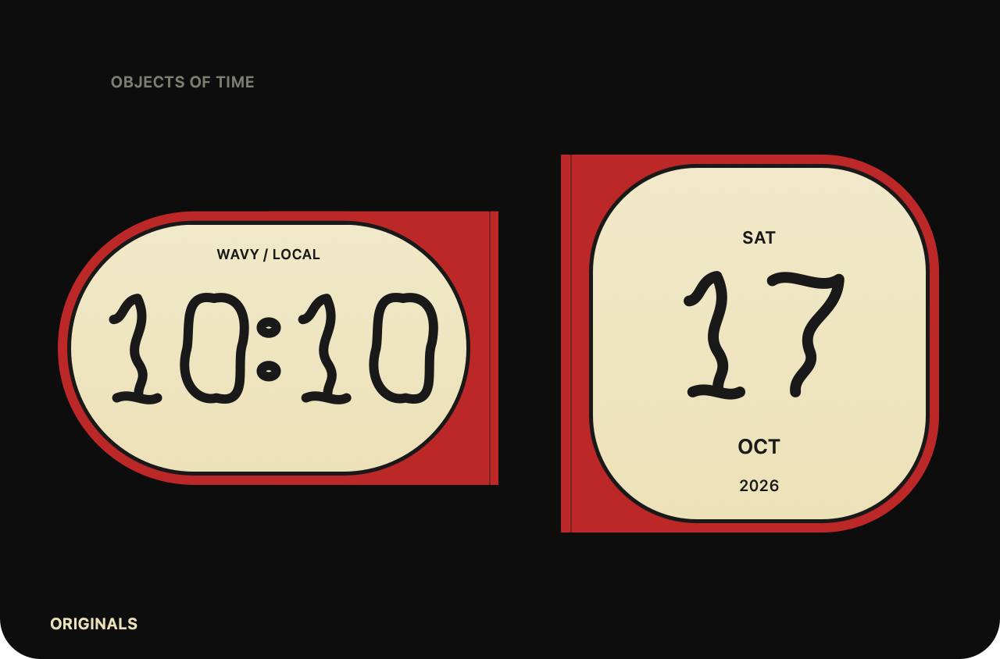
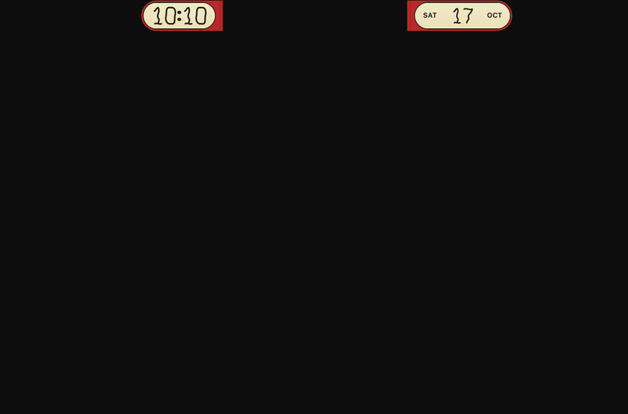

# Shared theme objects and hover morph

Implemented in `feature/coherent-widgets-hover-morph`, stacked above the Wavy numeral renderer.

## One theme, all components

Clock, calendar, and usage desk now share the same housing accent, cream material, ink bezel, mounting seam, and numeral renderer. Wavy uses custom vector numerals for time, day, and subscription percentages. Counter uses split tiles for those same values. Supporting labels remain native text for readability.

A theme plugin chooses colors and can recommend `family: "wavy"` or `family: "counter"`. The existing Visual family control remains an explicit override. Changing a component changes its information, not the selected family's appearance. The clock's design accent, when enabled by a legacy palette, supplies the housing accent for both sides.

[Wavy Objects](../examples/wavy-objects.clockpack.json) packages analog and digital clocks, calendar, usage desk, and a Wavy theme in one installable manifest. Existing version 1 manifests remain compatible. JSON selects native recipes; it cannot execute code or introduce arbitrary renderers.

The usage preview contains synthetic percentages, not account data.

## Hover behavior

Hover either compact wing to expand. Leaving the current panel starts a 120 ms exit grace, then collapses automatically. Re-entry cancels pending collapse or reverses an in-flight spring from its current position and velocity. There is no click latch, Expand/Collapse menu action, collapse button, or start-expanded setting. Old saved startup preferences remain readable but do not control expansion.

Menus temporarily suspend hover dismissal so submenu selection remains usable. Closing the menu reevaluates the pointer. Settings itself does not pin the expanded panel. Hide and sleep cancel pending hover dismissal, snap closed, and stop transition work. The camera cutout is excluded from hover and hit testing.

## Continuous geometry

`ClockContentView` owns exactly one clock and one companion view. Their frames interpolate from menu-bar wings to expanded desk positions. The same analog hands/markers or digital numerals, date digits, and usage percentages/tracks draw throughout the transition. Secondary labels reveal when there is space. No duplicate compact row or swapped detail panel fades in.

`MorphTransition` owns one critically damped spring and a 60 Hz timer only while moving. One scalar drives window position/size, component frames, housing contours, numeral geometry, and label positions. The top edge remains anchored to the measured display band. Reduce Motion snaps to the endpoint. At rest the animation timer is invalidated; the existing clock/provider refresh scheduling remains in control.

This GIF renders the same native views and spring at 20 frames per second with a fixed sample time. It is a reproducible design preview, not a recording of pointer input. The live app was checked separately for entry expansion and exit collapse on the built-in notched display.

## Validation

- 32 Swift tests pass, including spring reversal, rest endpoints, view identity across intermediate states, theme preservation, notch hit exclusion, and fixed top anchoring on an offset external-display geometry.
- Release build succeeds with no new dependencies.
- Native previews reviewed at 0%, 25%, 50%, 75%, and 100% for Wavy/Counter calendars and usage desks. Calendar labels stay separated during travel.
- Live native app verified expanding on pointer entry and automatically returning to the menu-bar band when the pointer leaves the usable region.
- CPU and memory probe results are recorded in [hover morph verification](HOVER_MORPH_VERIFICATION.md).

Run `zsh scripts/render-theme-previews.sh /tmp/theme-previews` for PNG endpoints, intermediate states, and motion frames. Rendering does not read or alter saved provider data. Physical external-monitor reconnection, older macOS versions, VoiceOver-only interaction, and live Reduce Motion transitions still require hardware/manual coverage. Hover-only operation intentionally removes the prior keyboard/click expansion alternative.
