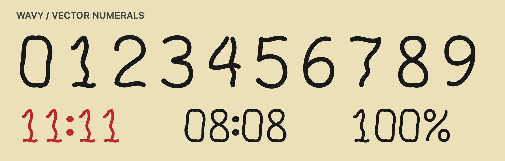
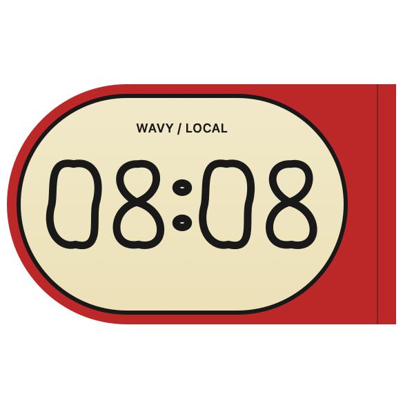

# Wavy numeral renderer

This is the first artwork layer on top of the Wavy/Counter settings foundation. Wavy digital clocks now draw vector numerals directly on the dial. Counter retains the existing tiles. Calendar and AI artwork and hover morphing are still pending in later layers of the [implementation plan](VISUAL_FAMILIES_AND_MORPH.md).

The normalized paths support 0–9, colon, and percent. Layout scales and centers a complete supported string in its target rectangle; unsupported text produces no partial output. Stroke widths derive from the rendered height, with a compact minimum for legibility. Native supporting labels remain unchanged. Both families still use the saved palette and 12/24-hour preference.

| Wavy compact | Counter compact |
|---|---|
|  |  |

Generate these native review assets with `zsh scripts/render-numeral-previews.sh output`. This renders views offscreen without launching the main app or changing settings. The sheet is a first design iteration, not evidence that the full coordinated widget family or motion work is finished.

Validation: 29 tests passed on the combined stack and `swift build -c release` succeeded. Glyph bounds are finite and normalized; compact and expanded string layouts cover `11:11`, `08:08`, `100%`, and day-boundary times. Native bitmap previews were inspected at compact and expanded sizes. No new timer, provider polling, dependency, or persistent animation was added.
